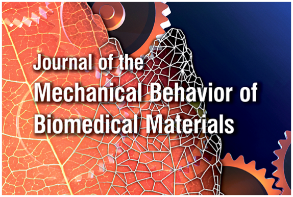

Hi, I am a Senior Postdoctoral Associate in the Department of Mechanical Engineering at [Boston University](https://www.bu.edu/), working in the [Skeletal Mechanobiology and Biomechanics Laboratory](https://morganresearchlab.org/) with Professor [Elise F. Morgan](https://www.bu.edu/eng/profile/elise-morgan-ph-d/). Previously, I completed my Ph.D. in the Department of Civil and Systems Engineering at [Johns Hopkins University](https://www.jhu.edu/), advised by Professor [Stavros Gaitanaros](https://orbit.dtu.dk/en/persons/stavros-gaitanaros/). Before that, I earned my M.S. in Civil Engineering from [Northwestern University](https://www.northwestern.edu/) and my B.S. in Civil Engineering from [Zhejiang University](https://www.zju.edu.cn/english/).

Research Interests
======
My research lies at the intersection of mechanics, materials, biology, and artificial intelligence within the broad realm of architected materials, spanning engineered metamaterials, human bone, and biomedical scaffolds, to deliver fundamental scientific insights and develop innovative material solutions to address pressing societal challenges through the following research thrusts:
- Mechanics, design, and manufacturing of engineered metamaterials
- Data-driven multiscale mechanics of human bone
- Generative AI for discovery and design of multifunctional architected materials

News
======

<strong>[Aug. 2026]</strong> Our <a href="https://www.sciencedirect.com/science/article/pii/S0925753526003024" target="_blank">paper</a> <em>"From occurrence to consequence: Unraveling urban building fire risk"</em> is now online in the <strong> Safety Science</strong>.

<strong>[June 2026]</strong> We have successfully completed the symposium on <em>Machine Learning in Biomechanics and Mechanobiology</em> and presented our work on <em>"A data-driven multiscale modeling framework for human vertebral mechanical behavior"</em> at the 2026 U.S. National Committee for Theoretical and Applied Mechanics conference (<a href="https://www.usnctam26.org/" target="_blank">USNC-TAM26</a>) — <strong>see you at future conferences!</strong>

<strong>[Mar. 2026]</strong> Our <a href="https://www.ors.org/wp-content/uploads/AM26/1557.pdf" target="_blank">work</a> on <em>"Data-driven multiscale modeling for vertebral trabecular elasticity"</em> has been presented at the <strong>Orthopaedic Research Society 2026 Annual Meeting</strong> in Charlotte, North Carolina.

<strong>[Mar. 2026]</strong> Our <a href="https://academic.oup.com/jbmr/advance-article-abstract/doi/10.1093/jbmr/zjag040/8534420?redirectedFrom=PDF" target="_blank">paper</a> <em>"From imaging to insight: biomechanical CT for fracture risk prediction"</em> is now online in the <strong> Journal of Bone and Mineral Research</strong>.

<strong>[Mar. 2026]</strong> Our <a href="https://www.nature.com/articles/s44455-025-00017-2" target="_blank">paper</a> <em>"Tension-compression asymmetry in brittle lattice metamaterials"</em> is now online in the <strong>npj Metamaterials</strong>.

<strong>[Oct. 2025]</strong> We are organizing a symposium on <em>Machine Learning in Biomechanics and Mechanobiology</em> at the 2026 U.S. National Committee for Theoretical and Applied Mechanics conference (<a href="https://www.usnctam26.org/" target="_blank">USNC-TAM26</a>) — <strong>abstract submissions are welcome!</strong>

<strong>[May 2025]</strong> I am glad to announce the establishment of the U.S. Association for Computational Mechanics (<a href="https://www.usacm.org/" target="_blank">USACM</a>) Local Student Chapter at Boston University and I am honored to serve as its Chair — <strong>stay tuned for our upcoming events!</strong>

<strong>[Mar. 2025]</strong> Our <a href="https://www.sciencedirect.com/science/article/pii/S1751616125000049?casa_token=o3IO8bhJ5xgAAAAA:itXt99_v_dnLwhjoUpteGpB9SAwhrGUkZTYTFvMn_Jc0gL-SWpmK9i-Ij4JJvlR56kN7pIZ5hwo" target="_blank">paper</a> <em>"A data-driven framework for developing a unified density-modulus relationship for the human lumbar vertebral body"</em> is now online in the <strong>Journal of the Mechanical Behavior of Biomedical Materials</strong>.

<strong>[Feb. 2025]</strong> Our <a href="https://www.ors.org/wp-content/uploads/AM25/1680.pdf" target="_blank">work</a> on <em>"A data-driven framework for the modulus-density relationship of the human lumbar vertebral body"</em> has been presented at the <strong>Orthopaedic Research Society 2025 Annual Meeting</strong> in Phoenix, Arizona.

